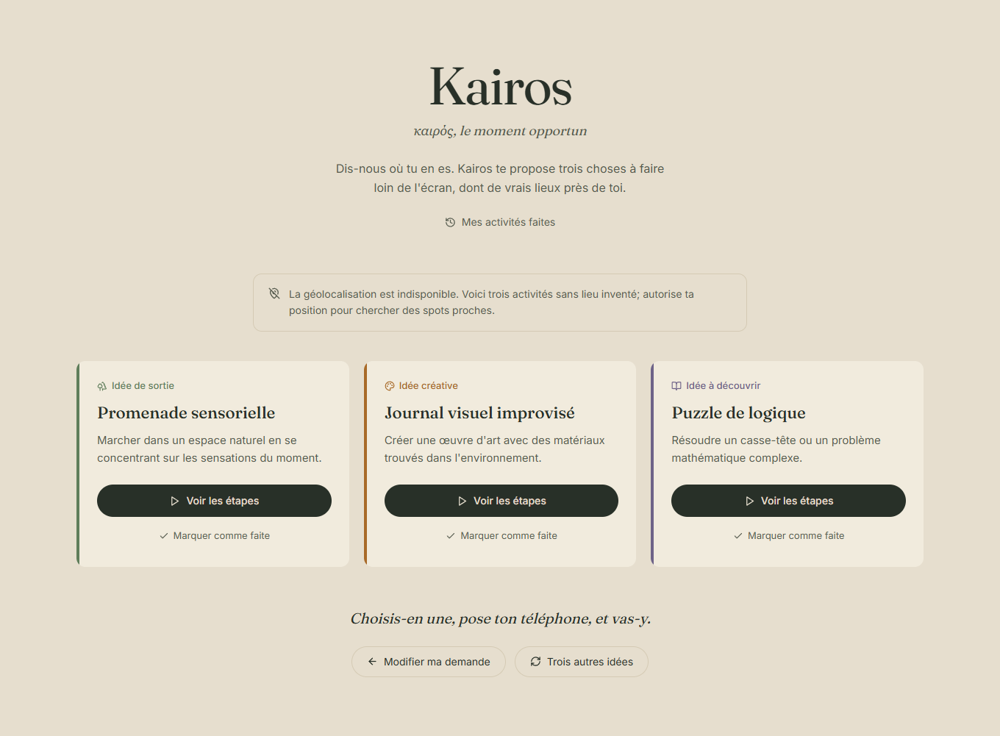
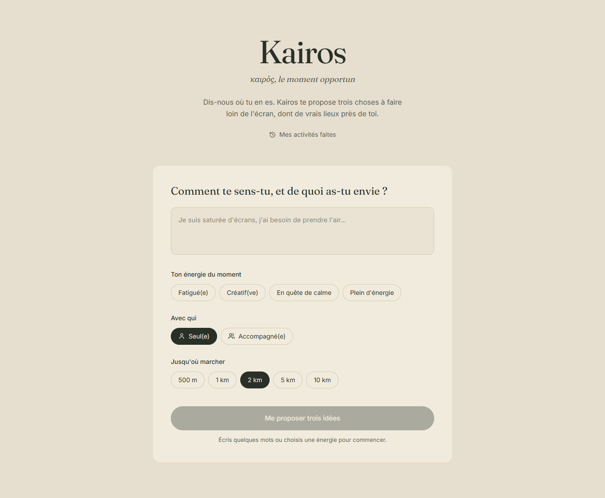
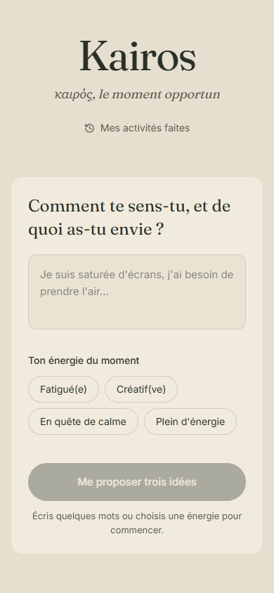

# Kairos

*καιρός: the opportune moment.*

**Kairos helps you put your phone down.** Tell it how you feel or what you're in the mood for,
and Kairos suggests **three concrete things to do away from the screen**: simple activities
you can start right away, and real places near you.

<p align="center">
  
</p>

> The app's interface is in French.

## Why three ideas, and no more

Doomscrolling runs on an endless feed. Kairos does the opposite: **three options, not one
more**, so you can choose quickly, put the phone down and go.

## What Kairos does

- **Understands your request**: your mood and what you feel like doing ("a quiet café to
  read").
- **Generates tailored activities** with an LLM, each with steps to follow, instead of picking
  from a fixed catalog.
- **Finds real places around you** (cafés, parks, museums, libraries, galleries) within 5 km.
  Each place comes with a photo, its rating, distance, opening hours and a Google Maps link.
- **Keeps only good places**: open right now, rated at least 4.2/5, with at least 10 reviews.
- **Suggests a film when you ask for one**: if your request mentions a film ("a funny film
  tonight"), one card becomes a popular, well-rated film from IMDb that fits the genre you named
  or your mood, with its poster, IMDb rating, number of votes, runtime and a French summary.
- **Remembers what you've done**: an activity marked as done is not suggested again.
- **Works without AI or location**: without an LLM it puts together fallback ideas; without
  geolocation it suggests activities with no place attached.

<p align="center">
  
  &nbsp;
  
</p>

## Quick start

**Requirements:** Python 3.10+ and Node.js 18+.

```powershell
# 1. Backend (http://localhost:8000)
cd backend
python -m venv .venv
.venv\Scripts\activate
pip install -r requirements.txt
copy .env.example .env          # then add at least one AI key (see below)
uvicorn app.main:app --reload --port 8000

# 2. Frontend (http://localhost:5173), in a second terminal
cd frontend
npm install
npm run dev
```

Open http://localhost:5173 and **allow location access** to see nearby places.
To check the backend, http://localhost:8000/api/health shows the active AI provider.

> The SQLite database (`backend/kairos.db`) is created on first launch. Delete it to clear
> the history.

## Configuration

All configuration lives in `backend/.env` (never committed).

### AI

Kairos uses the first provider whose key is set: **Ollama Cloud**, then **Gemini**, then a
**local LLM**. You can also force one with `LLM_PROVIDER`.

| Provider | What to put in `.env` |
|----------|-----------------------|
| Ollama Cloud | `OLLAMA_API_KEY=...` ([get a key](https://ollama.com/settings/keys)), `LLM_MODEL=gpt-oss:120b` |
| Google Gemini | `GEMINI_API_KEY=...` ([get a key](https://aistudio.google.com/apikey)), without `OLLAMA_API_KEY` |
| Local (Ollama, LM Studio) | `LLM_PROVIDER=local`, `LLM_BASE_URL=http://localhost:11434/v1` (LM Studio: port `1234`), `LLM_MODEL=qwen3:8b` |

### Places

| Source | Key | Cost | Recommended use |
|--------|-----|------|-----------------|
| **Google Places API** | `GOOGLE_PLACES_API_KEY` | Paid beyond the free quota | Production |
| **Google Maps search** | None | Free | Prototype, demo |

`PLACES_PROVIDER` picks the source: `auto` (default: the official API if a key is set,
otherwise Google Maps), `google_places` or `maps`. Quality thresholds are set with
`GOOGLE_PLACES_MIN_RATING` (default `4.2`) and `GOOGLE_PLACES_MIN_REVIEWS` (default `10`).

**Enabling the Google Places API:** in Google Cloud, enable **Places API (New)** and billing,
create a key restricted to that API, then add it to `.env`.

> ⚠️ **The keyless Google Maps search is not an official API.** Kairos replays the request
> that the Google Maps web page sends itself (found with
> [API Anything](https://github.com/goodnight000/api-anything)). Google can change or block it
> at any time, and using it in production violates its terms of service. For a deployment,
> use the official API.

### Films

Film suggestions use the GraphQL endpoint that imdb.com itself calls, with no key. Only films
rated at least `IMDB_MIN_RATING` (default `7.0`) with at least `IMDB_MIN_VOTES` votes (default
`25000`) are suggested.

> ⚠️ **This is not an official API either.** IMDb only allows limited, non-commercial use of
> its data. Fine for a personal prototype, not for a public deployment.

## How it works

```
Browser (React)  ──  mood, text, location  ────────▶  POST /api/kairos/recommend
                                                              │
                   ┌──────────────────────────────────────────┼──────────────────────┐
                   ▼                                          ▼                      ▼
          LLM: activity ideas                     Open places within 5 km     SQLite: activities
          (Ollama / Gemini / local)               (Places API or Maps)        already done, skipped
                   └──────────────────────────────────────────┬──────────────────────┘
                                                              ▼
                               3 suggestions: real places when available, filled in with ideas
```

## Stack

| Part | Technologies |
|------|--------------|
| Backend | Python, FastAPI, SQLModel (SQLite), httpx |
| Frontend | React, TypeScript, Vite, Tailwind CSS, Framer Motion |
| AI | Ollama Cloud, Google Gemini or a local OpenAI-compatible LLM |
| Places | Google Places API (New) or Google Maps search |
| Films | IMDb (GraphQL endpoint of imdb.com) |

## API

| Method | Route | Purpose |
|--------|-------|---------|
| `GET` | `/api/health` | Server status and active AI provider |
| `POST` | `/api/kairos/recommend` | Returns three suggestions |
| `GET` | `/api/kairos/history` | Lists completed activities |
| `POST` | `/api/kairos/history` | Marks an activity as done |

<details>
<summary>Example <code>POST /api/kairos/recommend</code> request</summary>

```json
{
  "user_input": "J'ai envie d'un café calme pour lire",
  "mood": "Fatigué(e)",
  "max_options": 3,
  "lat": 34.0209,
  "lon": -6.8416
}
```

The response always contains **exactly three** `recommendations`, plus `source` (`llm` or
`fallback`) and `places_source`, which tells where the places came from or why there are none
(`google`, `maps`, `google_no_match`, `no_location`…), and `film_source` (`none` when no film
was asked, `imdb`, `imdb_no_match` or `imdb_error`). An optional `radius` (300 to 10,000 m,
default 5,000) changes the search distance.

</details>

## Project structure

```
backend/app/
  main.py            FastAPI routes
  recommender.py     Core logic: AI + places + history
  google_places.py   Places from the official Places API
  maps_search.py     Places from Google Maps search (no key)
  imdb_search.py     Film suggestions from IMDb (no key)
  database.py        SQLite
  schemas.py         Data models
frontend/src/
  App.tsx            Main screen
  api.ts             Backend calls and geolocation
  components/        Form, cards, steps dialog, loading animation
docs/
  REPRISE.md         Project history and handover guide (in French)
```

## Known limitations

- The keyless Google Maps search is **fragile** and meant for prototyping only (see above).
- It returns at most **20 places per type**: in a large city, mostly popular places show up.
- It is set to **French and Morocco** (`hl=fr`, `gl=ma` in `maps_search.py`).
- The IMDb endpoint is unofficial too, and some French summaries from IMDb are clumsy.
- No automated tests yet.

## Going further

[`docs/REPRISE.md`](docs/REPRISE.md) (in French) explains in detail everything that has been
done, the design choices, the full configuration, what to do if the Google Maps search
breaks, and the planned next steps.
